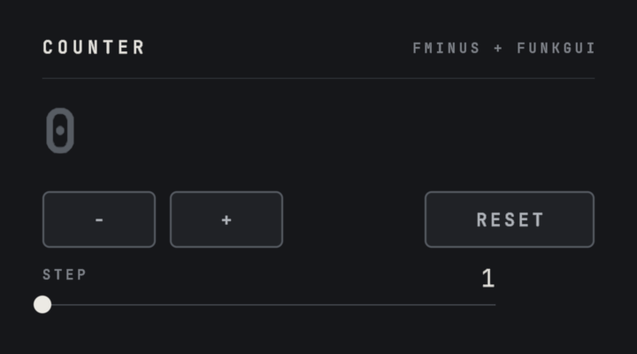
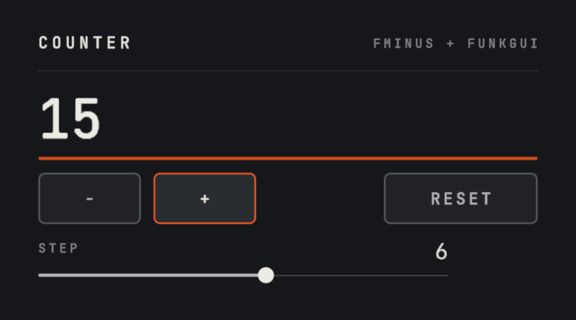
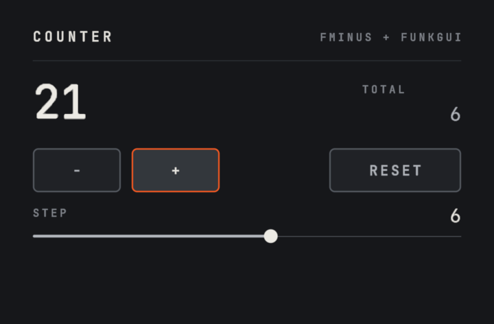

# Desktop applications in FMinus, drawn by FunkGui

*Research, 2026-11-23, written against FMinus at `19cbb91` (0.1.0) and [FunkGui](https://github.com/Snipet/FunkGui)
at `b7bc1cd` (v0.27.0). The question asked: research using FMinus and FunkGui to build desktop applications, in the
place Electron and Tauri hold but with no web interface, FMinus for the logic and FunkGui for the GUI, and with no
JUCE at all, for windowing or as a library. Nothing under `src/`, `include/`, `tools/` or `cmake/` changed for this
note, and nothing in FunkGui changed. One experiment was built and run, on Linux x86-64 ([experiments/](experiments/),
§12): an FMinus program that draws and takes input through FunkGui's JUCE-free core, from the JIT and from an
executable built ahead of time. §15 says what was run, what was read at its source, and what was neither.*

## 0. Summary

**It works, and the part the idea is about is the small part.** An FMinus program can drive FunkGui today, with no
change to either: its prototypes without definitions are C functions (docs/language.md), so a host defines `ui_rrect`
and its kin over `funkgui::Canvas`, and the program calls them. The experiment is a counter with buttons, a slider,
keys, eased hover states and accessibility items, 207 lines of FMinus:

| Measured (Linux x86-64, §12) | |
|---|---|
| The program compiled and linked by the JIT, `-O2` | 66 to 90 ms |
| The same program after an edit, compiled while the first ran, its state carried over by field name | 63 to 89 ms; 33 fields carried |
| One frame recorded (45 primitives: FMinus code calling the host for each) | 0.64 µs |
| The pictures from the JIT and from `fminus -c` linked ahead of time | the same bytes, three frames of three |
| The executable built ahead of time (FunkGui's core, the font atlas, the program; no window, no GPU layer) | 0.67 MB |
| The executable with the compiler inside | 77 MB (65 MB stripped, 17 MB as `xz`) |
| FunkGui's core, tools and tests built without JUCE, and its own gate (`tools/verify.sh`) | 63 tests, 63 pass |

**The large parts are the ones the idea does not mention.** A web view gives an application its text, layout, text
input, accessibility and widgets, and leaving it means building them. The toolkits that have done so say that is
where the years go (§1, Appendix A). For these two projects the list is specific:

- **FunkGui is cross-platform through JUCE.** Its window, events, timers, menus, file chooser, clipboard, cursors,
  screen-reader bridge and font rasteriser are JUCE's. What is JUCE-free is everything that does not touch the system
  (11.6k lines: the canvas, the widgets, the headless host) and, in its code though not in its CMake, the bgfx layer
  (2.5k lines). A desktop host is new code of about the size of `WebHost`, which is the precedent: FunkGui has
  already been taken off JUCE once, for the browser (§5).
- **Its text is one monospace face, printable ASCII and 19 symbols**, from one distance-field atlas, with a floor of
  10 px, no shaping and no input method. That suits a plugin's panel and no general application (§6).
- **FMinus compiles for the machine it runs on, which is the wrong machine when the program ships.** `fminus -o`
  takes the build machine's CPU as its target (`JITTargetMachineBuilder::detectHost`), has no `--target` or `--mcpu`,
  and links through a C++ toolchain it expects to find. The JIT does compile for the user's CPU, at the price of
  LLVM in every application (45 to 65 MB) and, on macOS, an entitlement (§8).
- **Both projects are GPL-3.0**, so an application that links them is a combined work under the GPL unless you, who
  own both, say otherwise (§10).

**What I would build**, in this order. Each step ends in something that runs, and §13 sizes them:

1. **A window without JUCE**, in FunkGui: the bgfx layer made a target of its own, and a `DesktopHost` beside
   `EditorHost` and `WebHost`, on SDL3. One window, the frame clock, input, DPI, resizing, the clipboard.
2. **A runner**: the executable that holds a Panel whose methods are an FMinus program's. With the compiler inside
   for development (compile, watch the files, reload and keep the state, errors on the window); with none for
   release, the program linked in.
3. **The binding as a library**: `ui.fm` and its C functions, grown from the experiment's eight to what a real
   interface needs (a text field, a list, a menu, rows and columns), still with no compiler change.
4. **Text**: proportional UTF-8 from bundled fonts (HarfBuzz and a coverage atlas beside the distance field), then
   input methods through SDL3.
5. **The platform's services**: menus, file dialogs, drag and drop, several windows, shortcuts.
6. **Accessibility** without JUCE, through AccessKit: FunkGui's `A11yItem` list is already the right input.
7. **Shipping**: a CPU baseline and a target for `fminus`, bundles, signing, updates.
8. **Into the compiler**, last: `ui_*` builtins with checked formats, behind `FMINUS_UI`, and a host's way to refuse a
   program's external functions.

**What I would not build:** a markup or a second UI language, a retained widget tree, windowing back ends of our
own, a web view to fall back on, an application with the JIT inside by default, rich text, the Mac App Store, phones.
§11 says why, and what would bring each back.

**What decides the design:**

- **FMinus already has the shape of an immediate-mode interface.** It has no callbacks ("C has no callbacks a program
  could be handed a request through, nor do FMinus programs"), so a program takes its events and asks its questions,
  as `serve` takes requests. Its state lives in modules, each instance's own. Its text is made only where it goes.
  Its identifiers for things are enumerators. Those are the four things an immediate-mode toolkit has to invent
  (§4).
- **The Panel is the asset.** FunkGui's contract (time only from `tick(dt)`, `draw` reads and never advances, input as
  plain structs) is why one program gave the same pixels from the JIT and from an executable, headless, with its
  accessibility items as text. An FMinus application inherits a test harness that no Electron application has (§3).
- **The compiler can keep a frame from waiting.** A function marked `[[clang::nonblocking]]` may call nothing that
  allocates or blocks, an external function included unless its prototype says so too. The experiment's `tick` and
  `draw` are marked, and compile; a `file_read` in either does not. A web toolkit asks its users not to block the
  UI thread; here the compiler would check it (§4.4).
- **JIT to write, ahead of time to ship.** That is Flutter's split, for Flutter's reasons. The interface does not
  need the speed (a frame is under a microsecond); the per-machine code is for the kernel the application is about, a
  DSP graph or a model, and an application whose point is that kernel can ship the JIT knowingly (§8).
- **A program states its reach.** FMinus lists every URL, route and file name a program can use before it runs, and
  grants none by default: Tauri's capability files, derived instead of written. It is a policy and not a sandbox, as
  docs/web.md says, and the first thing an application platform would add is the missing piece, an allow-list for
  external functions (§9).

**Decisions that are yours** (§14 has each with its reasons):

| Decision | What I would choose | The alternative |
|---|---|---|
| Where the shell lives | a third repository, with FunkGui and FMinus at pins | in FunkGui; under FMinus's `tools/` |
| The window layer | SDL3, static | GLFW and a file-dialog library, without input methods; back ends of our own |
| How a program draws | external functions in a library now, builtins when the names have settled | builtins from the start; a display list the program fills |
| The interface's style | immediate: the program draws when asked | a retained tree, described as modules |
| Text | bundled fonts, HarfBuzz, a coverage atlas; the distance field kept for large sizes | each platform's own text stack; multi-channel distance fields |
| Accessibility | AccessKit's C library, prebuilt, pinned by hash | native bridges by hand; a Rust toolchain in the build |
| What ships | an executable built ahead of time | the JIT in every application |
| Others' applications | yours to say | GPL only; a runtime exception; a second licence |
| The first application | an FMinus playground: an editor and what the program does | a preset or settings tool; FCompressor's standalone |

## 1. The idea, beside Electron and Tauri

Both are two things joined by a bridge: something that draws (a browser engine) and something that computes (Node, or
Rust), in separate worlds with messages between them. The idea here has the same two halves and no bridge.

| | Electron | Tauri 2 | FMinus and FunkGui |
|---|---|---|---|
| Draws with | its own Chromium | the system's web view: WebView2, WKWebView, WebKitGTK | FunkGui: primitives recorded on the CPU, one bgfx draw call a frame, on Metal, Direct3D 11 or Vulkan |
| The interface is written in | HTML, CSS, JavaScript | the same | FMinus (or C++, as a Panel) |
| The logic is written in | JavaScript, in Node | Rust | FMinus |
| Between the two | messages between processes | messages; commands by name | a C call, in one process |
| What the interface may reach | what Node can, unless isolated | capabilities: permissions and scopes for each window | what the host grants of the network and the disk: nothing by default, and listed from the program |
| One engine on every system | yes | no: three | yes: one rasteriser, with a CPU mirror of it for tests; the same pixels while the fonts are bundled |
| An empty application | 80 to 100 MB zipped (Electron's own figure) | 3 to 9 MB (others' measurements) | not built with a window. The headless core here: 0.67 MB. With the compiler inside: 65 MB stripped |
| Changing it while it runs | reload the page | the page reloads; Rust rebuilds | recompile in under 100 ms and keep the state (measured, §12) |
| Text, layout, input methods, accessibility, widgets | Chromium's | the web view's | to be built: §4.5, §6, §7 |

The last row is the cost of "no web interface", and the reason this note is long.

**Who has left the web view, and what they report** (Appendix A has the table and the sources; read by a survey
for this note, 2026-11-23):

- **It is being done, by those with a reason.** Zed built GPUI because in Atom "there was always something in the way
  of delivering frames on time", and reached 1.0 in April 2026. Discord is reported to have announced a move from
  Electron to GPUI in November 2026. Flutter, Slint, Qt Quick, egui, Iced, Makepad and Avalonia all ship desktop
  applications.
- **It is also being undone.** WhatsApp for Windows is reported to have gone from a native interface back to a web
  view in 2025, and AFFiNE from Tauri back to Electron, for the web's ecosystem and one engine's consistency.
- **The second half is the long one.** Raph Levien, two days before this note: immediate mode is "good at the first
  90%, but it makes the second 90% harder", for needing stable identities for accessibility and cached text layout.
  A test of Rust toolkits with a screen reader and a Japanese input method (April 2025) found that GPUI, Makepad and
  Floem showed the screen reader nothing, and that only some handled composition. Their renderers were not what
  they lacked.
- **The closest relatives chose two modes of one language.** Flutter chose Dart because it "supports both JIT … with
  stateful hot reload, and AOT … for efficient native machine code in production". Slint compiles `.slint` ahead of
  time and interprets it for live preview. Makepad runs its own DSL at run time beside compiled Rust. FMinus already
  is such a language: one front end, the JIT or an object file.

**What the idea gets right, and the three claims in it:**

- *"FMinus quickly generates code optimised for that machine."* True of the JIT, and quick (§12). Not true of what
  `fminus -o` writes for another machine (§8.3). And an interface does not need it: the argument for FMinus here is
  one language for the interface and for the kernel behind it, with no bridge between them, reload, and declared
  reach. The speed is for the kernel.
- *"FMinus already targets the major platforms."* The compiler does: macOS on Apple silicon, Linux x86-64 and
  Windows x64 are built and tested (docs/building.md). The parts an application leans on are less far along: the web
  library's macOS and Windows code "has never been built or run", the file interface's has been compiled there and
  never run, Linux on arm64 has not been built, and Windows is x64 only (§9).
- *"FunkGui is cross-compatible."* It draws on all three systems, inside a JUCE window. Without JUCE it has run in a
  browser and headless (here, on Linux: §15). The desktop host is step 1.

## 2. What each project brings

### 2.1 FMinus, as an application language

Read from docs/language.md, docs/library.md and docs/programs.md; the experiment used the lines marked *(run)*.

| What an application needs | What FMinus has | The gap |
|---|---|---|
| State | modules: fields that start at 0, methods, nesting, arrays of them; no top-level variables *(run)* | none: an application is a module |
| Being told of events | nothing: no function pointers, no closures. The host calls the program's functions, as C function pointers or, ahead of time, as symbols *(run)* | none, for an immediate interface (§4.2) |
| Calling the host | a prototype with no definition is an external C function, resolved in the process or by the linker *(run)* | it takes no `string` (a helper passes `string_data` and `string_size`: *(run)*); a host cannot refuse one (§9) |
| Text | `string`, a read-only view; `char` arrays to keep it; literals; `switch` on a string | nothing builds text: a number becomes text only in a sink (a reply, a URL, a file name). An interface needs sinks of its own (§4.3) |
| Numbers | `float`, `double`, `int` (32 bits), `bool`; vectors | no `long` and no `unsigned`: `0xFF5A1FFF` is an error *(run)*, so a colour is a theme token or three numbers, and a time stamp is a `double` |
| Collections | arrays of one or two dimensions, sized when compiled; `malloc` | no growing list, no map, no owning string. A list of documents is an array with a capacity. The data plan (docs/research/data/) leaves the same things out; an application is what would bring them back |
| Waiting without blocking | `http_get` returns at once and is polled; `when (c)` runs on a rising edge; `within (ms)` | reading a file blocks, and nothing starts a task: the shell has to (§4.4) |
| Promises about a frame | `[[clang::nonblocking]]`, checked through every call *(run)* | none |
| Development | the JIT; bounds checks and a loop budget that stop a call instead of the process; clang's error wording | none: these are what a reload needs (§8.4) |
| Shipping | `fminus -c`, `-o`; a runtime library with no LLVM | the build machine's CPU, the machine's own linker, a `main` of floats (§8.3) |
| The network, files, JSON, XML | builtins under a host's policy | macOS and Windows unproven (§9) |

### 2.2 FunkGui, without JUCE

Counted at `b7bc1cd` (lines of `src/`, `wc -l`); "no JUCE" means no `juce::`, `JUCE_` or `<juce_` in the file.

| Part | Lines | JUCE | Without it |
|---|---|---|---|
| Canvas, primitives, clipping, fingerprints, `SoftRaster`; widgets (`RuleSlider`, `Dial`, `SegmentedSelector`, `LatchToggle`, `TextEditor`, ...); `LineEdit`; accessibility items; themes, eases; `HeadlessHost` | 11,556 | none | as it is: the `nojuce` preset, which passes FunkGui's gate on Linux here (§15) |
| `BgfxContext`, `BgfxSink`, `ShaderLibrary`, `ImageGpu`, `GpuInfo` and their private headers | 2,520 | none in the code. `CMakeLists.txt` turns `FUNKGUI_WITH_BGFX` off with `FUNKGUI_WITH_JUCE` | a CMake change. `BgfxContext::acquire(void* nwh, int w, int h)` takes any window, up to 16 a process |
| `EditorHost`, `HostServicesJuce`, `FramePump`, `NativeSurface` (three systems), cursors, the display link | 3,082 | throughout: the host is a `juce::AudioProcessorEditor` | new: `DesktopHost` (§5). `WebHost` and `WebServices`, its JUCE-free counterpart for a browser, are 1,441 |
| `A11yBridge` | 483 | invisible `juce::Component`s for VoiceOver; nothing on Linux | AccessKit (§7) |
| `MenuLook` | 658 | draws `juce::PopupMenu` | menus drawn by the Canvas (§5.4) |
| The font bake | 217 | JUCE's rasteriser; a build without it loads the committed `fonts/FunkGuiAtlas-macos.bin` | replaced by the text work (§6) |
| PNG writing, the preferences file | 164 | JUCE's encoder and properties file | a small encoder (the experiment has one, 40 lines on zlib); a file backend behind `UiPreferences::setBackend` |
| Presets | 2,394 | JUCE and SQLite | a plugin's matter; an application would use FMinus's files |

What makes FunkGui worth the trouble is its contract more than its renderer. A Panel "reads no wall clock", every
ease "snaps onto its target", so with a fixed `dt` a headless run settles in a counted number of frames and draws the
same frame every time; `SoftRaster` mirrors the fragment shader on the CPU; a fingerprint hashes a frame's geometry
and text. The experiment's frames have fingerprints and pictures with no GPU and no window (§12), and FunkGui's
harness would hold an application's goldens the way it holds FCompressor's.

### 2.3 What neither has

A top-level window and an event loop. Menus, dialogs and drag and drop that are not JUCE's. Text beyond ASCII in one
face, and any input method. Layout beyond arithmetic. The plain widgets of an application: a button, a checkbox, a
text field as a widget (its state, `LineEdit`, exists), a list, a table, tabs, a tree. An accessibility bridge on
Linux at all. A way to make an installer. And, since JUCE also gave a standalone plugin its audio device, an audio
and MIDI layer for an application that plays: SDL3 has audio devices and streams; MIDI is not in SDL3 (from memory,
not checked).

## 3. The shape

```
app.fm          the application: modules of state, and functions the shell calls
   |                tick(dt), draw(), pointer(x, y, phase), key(k), accessibility(), action(id, what, value)
   |  calls ui_* : C functions today (§4.1), builtins later (§4.3)
the binding     ui.fm and its C functions, over funkgui::Canvas and the widgets
   |
FunkGui core    Panel, Canvas, widgets, text, accessibility items                 exists, no JUCE
   |
the shell       DesktopHost: the window, the loop, the frame clock, input, HostServices        to write (§5)
   |-- SDL3         windows, events, input methods, the clipboard, dialogs, drag and drop
   |-- bgfx         BgfxContext, BgfxSink                                         exists; CMake ties it to JUCE
   |-- AccessKit    the screen reader's tree                                      §7
   +-- the runner   with the compiler: compile, watch, reload.  Without: the program is linked in     §8
```

The seam in the middle is `funkgui::Panel`. The experiment's host is one Panel, `FmPanel`, whose every method
forwards to a function of the program:

```cpp
void tick(float dt) override { app_.tick(instance_, dt); }
bool wantsFullRate() const override { return app_.moving(instance_); }
void draw(funkgui::Canvas& canvas, const funkgui::Theme& theme) override
{
    gCanvas = &canvas;                    // what the program's ui_* calls record into, for this call
    gTheme = &theme;
    app_.draw(instance_);
    gCanvas = nullptr;
}
void pointerDown(const funkgui::PointerEvent& e) override { app_.pointer(instance_, e.x, e.y, kDown); }
```

Everything above the seam is the same whether `HeadlessHost` runs it in a test, `WebHost` in a browser, or a
`DesktopHost` in a window, and whether `app_` came from the JIT or from the linker. That is why the experiment could
be run here, where there is no display, and still say something about a window.

## 4. The binding: how an FMinus program draws

### 4.1 External functions, which work today

`ui.fm` is the whole binding of the experiment: enumerations for the theme's tokens and the type scale's styles, eight
prototypes, and three small functions (two that pass a `string`'s halves, and an ease).

```c
enum Ink { GROUND, INK100, INK70, INK52, INK32, INK16, ACCENT, ACCENT_DIM, SIGNAL };       // funkgui::Theme's tokens
enum Style { DISPLAY, VALUE_P, VALUE_S, NUMERAL, WORDMARK, LATCH, LABEL, CAPTION, MICRO, UNIT };

void ui_rrect(float x, float y, float w, float h, float radius, int ink, float alpha) [[clang::nonblocking]];
void ui_text_bytes(const void* utf8, int bytes, float x, float y, int style, int ink, int align) [[clang::nonblocking]];
void ui_int(int value, float x, float y, int style, int ink, int align) [[clang::nonblocking]];

void ui_text(string s, float x, float y, int style, int ink, int align) [[clang::nonblocking]]
{
    ui_text_bytes(string_data(s), string_size(s), x, y, style, ink, align);
}
```

and a widget is a module:

```c
module Button
{
    float x, y, w, h;
    float glow;                                   // 0 at rest, 1 under the pointer: eased, never set
    float press;
    bool hot, held;

    void tick(float dt) [[clang::nonblocking]]
    {
        glow = toward(glow, hot ? 1.0f : 0.0f, dt, hot ? 0.09f : 0.16f);
        press = toward(press, held ? 1.0f : 0.0f, dt, 0.05f);
    }

    void draw(string label) [[clang::nonblocking]]
    {
        ui_rrect(x, y, w, h, 4, INK16, 0.35f + 0.65f * glow);
        ui_rrect(x, y, w, h, 4, ACCENT_DIM, press);
        ui_frame(x, y, w, h, 4, 1, hot ? ACCENT : INK32, 1);
        ui_text(label, x + w / 2, ui_cap_centre(y + h / 2, LATCH), LATCH, hot ? INK100 : INK70, CENTRE);
    }
};
```

What the compiler said of the boundary, each tried on the built `fminus` (§15):

- A literal passed straight to an external `const char*` is an error, as language.md says it is (`incompatible
  pointer types passing 'char[6]' to parameter of type 'const char *'`).
- An external function with a `string` parameter is an error that names the way round it: `an external function
  cannot take or return a 'string' yet: C passes a struct by each platform's own rules; define 'ui_text_s' in the
  program, or pass string_data(s) and string_size(s)`. The helper above is that advice, and with it a call reads
  `ui_text("COUNTER", 24, 20, WORDMARK, INK100, LEFT)`.
- A `[[clang::nonblocking]]` function that calls an unmarked prototype is an error; with the prototypes marked, the
  program's `tick`, `draw` and `accessibility` compile as nonblocking.
- The object file of the whole program has eight undefined symbols, the eight `ui_*` functions, and nothing of
  FMinus's runtime: 4,837 bytes of code.

What this way does not give: formats (the experiment has `ui_int` because nothing in FMinus turns a number into text
outside a sink), any check that an id or a style is one the host knows, and any limit on which C functions a program
may name. It is enough to build on, and that is the point of starting with it: the binding's names will change as the
first real application is written, and a library is cheap to change.

### 4.2 Why immediate mode

A retained toolkit hands a program its events through callbacks, and FMinus has none. Its own answer, from the web
server, is that a program takes what is waiting: `serve` and `route` are that answer given syntax. For an interface
the same answer is the immediate one: the program is asked to draw, and asks as it goes whether the button it is
drawing was pressed. FMinus brings what immediate-mode libraries have to invent:

- **Identity.** Immediate-mode libraries hash a label or a call site to know that this frame's button is last
  frame's. The experiment's are enumerators, `enum { ID_MINUS = 1, ID_PLUS, ID_RESET, ID_STEP };`, which are stable
  across frames, across a reload, and in the accessibility tree, where egui and GPUI derive theirs (a hashed widget
  id, a global element id).
- **State.** An ease, a caret, a scroll offset lives in a module's field, zero at first, with no registry of widget
  state keyed by id.
- **Text.** A label is a literal or a view of bytes something else owns. Nothing is allocated to say "Reset".
- **Idleness.** Immediate mode is charged with redrawing every frame. FunkGui's Panel already answers that: the host
  asks `needsDraw()` and `wantsFullRate()`, skips a frame recorded equal to the last one drawn, and an editor at rest
  costs no GPU time (FunkGui's README, 0.25.0). The experiment's program answers `moving()` from its eases.

Where immediate mode is hard, by its own authors' account (Appendix A), and what this design does about each:

| The hard part | Here |
|---|---|
| Layout needs sizes before anything is drawn | §4.5 |
| Stable identities for accessibility | enumerators; a list's rows are an id and an index |
| Text layout recomputed every frame | the sink caches by its bytes and style, in the shell; FunkGui's `TextEditor` already keeps its lines' spans |
| Large lists | the program draws the rows in view: `TextEditor::visibleLineRange` and `widgets/Scroll.h` are that pattern |
| Text editing | not immediate: a field is the shell's object (`LineEdit`, `TextEditor`), and the program holds its buffer |

### 4.3 Builtins, when the names have settled

The web library and the files began the same way round: first what a program would do, then builtins whose string
arguments are literals the compiler reads. An interface gains the same things from being known to the compiler:

- **Formats.** `ui_text(x, y, LABEL, "%.1f dB", level)`, checked as `http_reply_text`'s format is, written by the
  runtime's writer straight into the sink's buffer. This keeps "text is made only where it goes" and removes
  `ui_int`. For text a program must keep (a field's buffer, a file's name), one more sink: a `char` array.
- **The host's lists.** `Program::webRoutes()` lists every route before anything runs. `Program::uiText()` could list
  every literal an interface shows, which is a translator's catalogue for nothing, and every shortcut and menu item,
  which is what a system's menu bar is built from.
- **Handles.** `ui_image`, `ui_font`, `ui_window`: C's opaque pointers, typed, as `json_doc` is.
- **Effects.** Each builtin's line in `kRuntimeFacts` says what it allocates and whether it waits, so a marked `draw`
  is checked without trusting a prototype's attribute.
- **A build option**, `FMINUS_UI`, off by default, with `__FMINUS_UI__` for a program to test, as `FMINUS_WEB` has.

It is the last step and not the first because each builtin is a recipe of docs/extending.md and a promise to keep,
and the surface is not known yet. There is also a third way, which I would keep in mind and not build: the program
fills an array of a `Prim` module and the host replays it. It needs no calls at all and would let `draw` run in a
`parallel for`, but it puts FunkGui's primitive layout in every program, and a primitive costs 14 ns here already,
the call and the recording together.

### 4.4 A frame that cannot wait

`[[clang::nonblocking]]` is FMinus's promise to the audio thread: nothing the function reaches allocates or blocks.
The same promise suits the thread that draws. With the entry points the shell calls every frame marked, as the
experiment's are, a program cannot read a file, wait for a response or take a lock while a frame is due: the compiler
refuses it, in clang's words. Web toolkits ask their users not to block the UI thread; this would be a property of
the build.

That raises the question a web page answers with promises: where does the slow work go? FMinus has two of the three
pieces. A request is a handle that comes back at once and is polled (`http_status` is wait-free), so `when
(http_status(r) != 0) { ... }` in `tick` is the whole of it. A `parallel` region finishes where it ends, so it is for
making one frame's work faster and not for work that outlasts a frame. What is missing is a task: reading a large
file, parsing it, training on it. I would give that to the shell before the language: the program asks the shell to
run one of its own functions (`ui_job(JOB_LOAD)`), the shell calls it on a worker thread, and a later frame is told it
ended. What the job and the frame may both touch is then a convention, as it is between `init` and `process` in a
plugin today. A language answer (`async`, which docs/research/syntax/ §7.3 put off) can wait for an application that
shows the convention failing.

### 4.5 Layout

FunkGui's Panels lay out "in absolute logical px of a fixed-size window", and since 0.18.0 a Panel may be resized and
told its new size. The counter does the arithmetic itself, which is how FunkGui's own panels are built and is right
for an instrument's face. An application needs rows that share a width, text that wraps, a pane that scrolls and a
window that can be made small. The options:

- **Arithmetic in FMinus**, with helpers (`Rect` as a module, `split`, `inset`). No new machinery; it is what the
  experiment did. It stops scaling at the first interface whose sizes depend on its text.
- **Rows and columns in the shell.** The program brackets its drawing, `ui_row(...)`, `ui_column(...)`, `ui_end()`,
  giving each child a fixed size, a share, or "what it needs". The shell resolves a frame's boxes in a first pass in
  which the Canvas records nothing, then calls `draw` again to record. Because a Panel's `draw` "reads state and
  never advances it", calling it twice is allowed, and at 0.64 µs a pass it is free. Immediate-mode libraries
  usually lay out as they draw and borrow the last frame's sizes where they must; a program whose `draw` is a
  function of its state alone does not have to.
- **Clay itself**: a single C header, layout only, which emits render commands. Its hover test uses the last
  frame's positions, by its own account.

I would take the second, written in FunkGui beside the widgets, and look at Clay's algorithm before writing it.

## 5. The shell: FunkGui without JUCE

### 5.1 What has to be written

`EditorHost` is a `juce::AudioProcessorEditor` "that runs one Panel on the GPU". It owns the render view, registers
it with `BgfxContext`, is a client of the `FramePump`, records each frame with a member Canvas and submits it through
`BgfxSink`, converts JUCE's events into the Panel's plain structs, mirrors the accessibility items, and implements
`HostServices`. `WebHost` does the same list of jobs over a `<canvas>` with no JUCE, and its header says so:
"EditorHost's counterpart". A `DesktopHost` is the third of the family, and most of its hard decisions are already
made in the other two: the frame's order, the zoom, the unchanged-frame rule, the teardown.

Under it, the bgfx layer needs one thing of a window, its native handle. `BgfxContext` runs bgfx in single-threaded
mode on the message thread, takes the first window as the default swap chain and gives each later one a frame buffer
of its own, so several windows are already there. The work is in CMake (`FunkGui::gpu` is defined only with JUCE, and
`NativeSurface`'s three files make child views of JUCE's peer, where a desktop host hands over a top-level window)
and in two places where the code leans on JUCE lightly: the pump's clock and timer, and `GpuPicture`'s hop to the
message thread.

**bgfx is behind.** FunkGui pins bgfx.cmake `v1.153.9385` (API 153). The survey for this note found bgfx's master at
API 171, and that API 158 (September 2026) changed how a window is handed over: a `SwapChain` structure per window,
resized in place, with the handle taken out of `PlatformData`. At 153 a second window's resize means destroying and
making its frame buffer, which is the two-frame wait `BgfxContext.h` describes for Direct3D 11. A desktop host with
more than one window should start after that bump, and the bump is FunkGui's own golden gate to pass first.

### 5.2 The window layer

Read by a survey for this note at each project's tagged source (Appendix B has the details):

| | SDL3 3.4.20 | GLFW 3.5.1 | Our own back ends |
|---|---|---|---|
| Size | about 580k lines; static; on Linux it needs the system's X11, Wayland and D-Bus headers | about 36k lines | GLFW's four are 22k lines, without what is below |
| Several windows, popup windows | yes | windows; no popup or parent | ours |
| Input methods | composition and candidate events, the candidate window's place | none; a pull request open since 2022 | ours, four times |
| Clipboard | text and any type | text | ours |
| File drag with the pointer's position | yes | paths only | ours |
| File dialogs, tray | yes: the system's panels; the portal on Linux | no | ours |
| Menus | no (a pull request is open) | no | `NSMenu`, `HMENU` |
| A loop that sleeps | `SDL_WaitEvent`, woken from any thread | `glfwWaitEvents` | ours |
| Drawing while the window is resized | a timer inside the system's modal loop, which calls back on the main thread | callbacks inside it | ours |
| Licence | zlib | zlib/libpng | GPL-3.0 |

**SDL3**, for the row "input methods" alone: it is the one layer that has them on all four of macOS, Windows, X11 and
Wayland, and writing them is the least rewarding work on the list. It also brings the dialogs, the clipboard types,
drags with a position and popup windows, each of which FunkGui's `HostServices` already has a call for. Its cost is
weight and a break with "every dependency built from a pinned source": on Linux it wants system development
packages. Three risks would change the answer, and each is worth a day's spike before step 1 is called done:

- **Resizing on macOS.** A window's edge and its picture stay together only if the frame is presented inside the
  system's transaction. SDL fixed that in its own renderer in November 2026; bgfx's Metal back end has no such path,
  at the pin or on master (the survey's reading). If the result looks bad, the cure is our own `NSView` and layer and
  a patch to bgfx, which is most of a Cocoa back end.
- **Drawing on demand on Wayland.** bgfx's Vulkan back end can present to a Wayland surface since 2023, but a window
  that is covered can still block a present on compositors without the `fifo-v1` protocol, and SDL falls back to
  XWayland there. FunkGui on Linux draws every frame today for a related reason (`NativeSurface.h`: nothing tells it
  when a window's picture is lost).
- **The pin.** If system packages on Linux are not acceptable, GLFW and a file-dialog library build from source, at
  the price of input methods, drags with a position, popups and the tray.

### 5.3 The loop

A plugin's editor is ticked by its host's message loop; FunkGui's pump runs every open editor from one clock, at the
display's rate while anything moves and 12 Hz otherwise. An application owns its loop, and can do better at rest:
when no Panel wants full rate and none needs drawing, block in `SDL_WaitEvent` until input or a timer, and draw
nothing. The Panel's contract already has the three answers that needs (`wantsFullRate()`, `needsDraw()`, and
`idle()` for the gestures that close on a clock). While something moves, frames should come from the display: on
macOS 14 the view's own display link (`CVDisplayLink` is deprecated from macOS 15), on Windows a wait on the swap
chain, on Wayland the surface's frame callback. Neither SDL nor GLFW exposes those; FunkGui's `DisplayLink` has the
macOS one already.

### 5.4 The services

`HostServices` is the list, and each has a JUCE-free precedent in `WebHost` or a call in SDL3:

| Service | Today (JUCE) | In a desktop host |
|---|---|---|
| Popup and context menus | `juce::PopupMenu` drawn by `MenuLook` | drawn by the Canvas in a popup window: one implementation, the theme's look, on every system (`MenuRequest` already carries rows, sections, radio items, shortcuts and submenus) |
| The application's menu bar | none: a plugin has none | macOS: an `NSMenu`, installed before SDL starts, built from the program's commands. Windows and Linux: a row in the window, drawn. GNOME's guidelines describe no menu bar |
| File chooser | `juce::FileChooser` | `SDL_ShowOpenFileDialog` and its kin, which are asynchronous, as `chooseFiles` already is |
| Clipboard | `juce::SystemClipboard`, text | SDL's, text first |
| File drops | JUCE's, with enter, move and exit | SDL's drop events carry the position |
| Cursors | JUCE's and two of the system's | SDL's twenty system cursors |
| Speech (`announce`, `a11yFocus`) | JUCE's accessibility | AccessKit (§7) |
| Unbounded drags | JUCE's | SDL's relative mouse mode |

And four an application needs that a plugin never did: **commands** (a name, a shortcut, enabled or not: what a menu
bar, a context menu and a key all invoke), **focus and the Tab order** (FunkGui has a `FocusRing` and no focus
manager), **several windows** (a Panel each; a dialog is a window), and **the application's own events** (a file
opened from the Finder, a second launch, the system's theme changing). None is hard. They are named here because
they shape the binding: a command is exactly an enumerator and a literal, the kind of thing §4.3's lists would hold.

## 6. Text

This is the largest piece of work in the note, and the one the phrase "FunkGui for the GUI" hides.

**What FunkGui has.** One atlas, 1024 by 512, of signed distances baked at 48 px from a subset of JetBrains Mono:
codepoints 33 to 126 and 19 more (`text/Glyphs.def`), append-only because every golden's text hash depends on the
order. `Canvas::text` places glyphs by their advances: no shaping, no kerning, no fallback, and `missingGlyphs`
counts what it could not draw. "10px is the hard floor" (`core/TypeScale.h`). `LineEdit` keeps "printable ASCII
(32..126, what the atlas draws for typed text)", and `text::printable` writes anything else as `?`. A `KeyEvent`
carries one `char32_t`. The bake needs JUCE's rasteriser, or the committed blob.

That is a deliberate design, and a good one for its job: one face, hierarchy "from size, case, tracking, colour and
the SDF weight axis", identical on every machine. A general application breaks each assumption: a person's name, a
file's name, a sentence in the user's language, body text at 12 px in a proportional face.

**What the others do** (read by a survey for this note; Appendix C):

- Distance fields do draw interface text elsewhere (Qt Quick's default renderer, Makepad), and their users say where
  they give out. Unreal's documentation: distance-field text "does not support hinting. This can negatively affect
  quality at small font sizes". msdfgen's own README says antialiasing is likely to fail when the distance range
  covers less than two screen pixels; a 32 px atlas with a range of 4, drawn at 12 px, has 1.5.
- The method the last two years moved towards is a **coverage atlas**: glyphs rasterised at the size they are drawn,
  a few sub-pixel positions each, cached in a texture. GPUI, egui (which moved to hinted masks in 0.34) and Dear
  ImGui (a dynamic atlas since 1.92) do this; Qt Quick offers it beside its distance fields.
- Shaping is HarfBuzz nearly everywhere (Qt bundles it; egui uses its Rust port). GPUI uses each system's own stack
  instead (CoreText, DirectWrite, cosmic-text on Linux): native-looking text, three back ends, and different pixels on
  each system.

**The choice that matters to FunkGui** is that last one, and I would choose against GPUI's: bundled fonts and our own
rasteriser, on every system. It keeps the property the whole test method rests on (the headless frame is the live
frame, and `SoftRaster` can draw it), at the price of text that looks like FunkGui and not like the system. Fallback
fonts for scripts the bundle lacks would come from the system later, and those glyphs would be outside the goldens.

**Stages**, each usable alone (sizes are the survey's, compiled `-Os` for x86-64, before the linker drops anything):

| Stage | Adds | Dependencies | What FunkGui changes |
|---|---|---|---|
| 1. Proportional text | any bundled face, UTF-8, kerning and ligatures, 11 to 14 px that reads well | HarfBuzz 15 (0.9 MB), and a rasteriser: HarfBuzz's own `hb-raster` (64 KB, unhinted, new in 15.0) or FreeType 2.15 (0.4 to 0.6 MB, hinted) | a second texture, filled as glyphs are first drawn; a primitive kind that samples coverage; the same in `SoftRaster` and in the dump; measurement by shaped runs |
| 2. Any language | right-to-left runs, line breaking, grapheme-wise carets, fallback faces, colour emoji | SheenBidi (77 KB), libunibreak (131 KB), a fallback finder for each system, an RGBA page for emoji | `LineEdit` and `TextEditor` move from bytes to graphemes; wrapping by the Unicode rules |
| 3. Input methods | composition shown at the caret, the candidate window placed | SDL3's text input | `KeyEvent` gains text and composition events; the fields draw marked text |

Stage 1 touches what FunkGui's CLAUDE.md calls one unit: `Prim`, the vertex layout, `expand()`, `instance()`, both
vertex shaders, `fs_ui.sc` and `SoftRaster` change together, and `fg.canvas.instance` and `fg.gpu.instancing` hold
them equal. It is a real release of FunkGui with every golden touched, and it is worth doing whether or not anything
else in this note happens, because FCompressor's preset names are a person's text too.

SDL3's input methods have known gaps (the survey read its source): no surrounding-text interface, so no reconversion
on any system; Windows through IMM32 only. Enough for composing Chinese, Japanese and Korean into a field; not
everything a native field does.

**FMinus's side of text** is smaller. Its strings are bytes with a length and no encoding checked, which is what
UTF-8 wants. A program keeps text in `char` arrays, and for an interface it needs two things it lacks: a way to write
formatted text into one (a sink, §4.3), and nothing else, if the editing itself stays in the shell's widgets.

## 7. Accessibility

FunkGui has the model: a Panel lists an `A11yItem` for each thing a person can operate (an id, a parent, one of
sixteen roles, bounds, a title, a value and its range, table geometry), bumps a revision when the list changes, and
takes actions by id. The experiment's program lists four, and they print as FunkGui's tests print them (§12). What
turns the list into something VoiceOver reads is `A11yBridge`: invisible JUCE components. On Linux JUCE has no
accessibility at all, so FunkGui has none there today.

**AccessKit** is the same idea made a library: the application pushes a tree of nodes with ids and roles, then
updates; adapters speak UI Automation, NSAccessibility and AT-SPI. egui, Xilem, Godot and GPUI's main branch feed
it. FunkGui's list maps onto it almost field for field, and stable ids, the thing immediate-mode toolkits have to
derive, are already the program's enumerators. The survey's findings on its C library, `accesskit-c` 0.23.2:

- It is Rust. Building it needs a Rust toolchain (its CMake fetches Corrosion), which neither project has. Its
  releases carry prebuilt static and shared libraries for macOS, Windows and Linux with a CMake package: 0.4 MB on
  Windows, 0.8 MB on macOS, 2.0 MB on Linux, stripped.
- It has no rich text yet, which matters to an editor and not to a form.
- Godot's integration of it was an open pull request for two years. That is the one figure found for the effort, and
  it is for an engine far larger than FunkGui.

I would take the prebuilt library, pinned by version and hash as every other dependency is, and say in the build
that it is the one dependency not compiled from source. The alternative, three native bridges by hand, is the work
AccessKit exists to share. Rules do not force the choice for most desktop software (the European Accessibility Act
covers listed consumer products and services; Section 508 binds what United States agencies buy), but a toolkit
without it is one a public body cannot adopt, and §1's test suggests it is what new toolkits leave for last.

## 8. Shipping: the JIT, ahead of time, or both

### 8.1 What each means

Sizes are measured here (Linux x86-64, Release, static LLVM 23.1.3 with one target); the platform rows were read at
their sources by a survey for this note.

| | Ahead of time | The JIT inside |
|---|---|---|
| The counter, with FunkGui's core and no window layer | 0.67 MB (0.09 MB gzipped: most of it is the atlas) | 77 MB; 65 MB stripped; 25 MB gzipped, 17 MB as `xz` |
| The least an LLVM JIT with the `-O2` pipeline can be | | 44.5 MB stripped (the survey built one against this checkout's LLVM); FMinus's `example-hello` is 59.6 MB |
| Start | nothing to do | the program compiled first: 66 to 90 ms for the counter; an object cache (`llvm::ObjectCache`) would skip it on later runs |
| Code for the user's CPU | no: for a baseline | yes |
| Reload | no | yes |
| macOS, signed and notarised | nothing special | an entitlement. LLVM's JIT does not map memory with `MAP_JIT`, so `allow-jit` alone is not enough for it: `allow-unsigned-executable-memory`, or a memory manager of our own. Julia ships both entitlements. The Mac App Store is doubtful: a 2026 report of a sandboxed JIT application crashing on macOS 26 was answered by Apple with "official guidance hasn't changed" |
| Windows | nothing special | no entitlement. LLVM links JIT'd COFF with its older linker (FMinus does: `Jit.cpp`); its newer one has no arm64 COFF back end |
| Linux | nothing special | SELinux's `execmem` where it is enforced |

docs/library.md says of macOS that a JIT host needs "`allow-jit` (for `MAP_JIT`) or
`allow-unsigned-executable-memory`". The survey's reading of LLVM (its memory manager maps read-write and then
changes the protection, and `MAP_JIT` appears nowhere in its JIT) says the first of those would not be enough for
FMinus as built. Neither was run: this container is Linux. It is worth a test on your machine before anything is
signed.

### 8.2 The recommendation

Develop with the JIT; ship ahead of time. The interface gains nothing from per-machine code (0.64 µs a frame), an
application of a few megabytes (not yet measured with a window in it: §15) is the argument against Electron that a
person can check, and an executable with no compiler in it needs no entitlement and no answer to "can it generate
code?". Flutter made the same choice.

The exception is an application whose subject is code or signal: a synthesiser that lets its user write a filter, a
tool that compiles a circuit (docs/circuits.md), a notebook. There the JIT is the feature, FMinus Filter
(`examples/plugin/`) is already built that way, and 60 MB is what Electron costs anyway.

### 8.3 What `fminus` lacks for shipping

Read in the source at `19cbb91`:

- **The target is the machine that compiles.** `hostFileTargetMachine` is
  `JITTargetMachineBuilder::detectHost()` with a code model: the build machine's CPU and features. Run here, where
  `fminus-hostinfo` says `cpu: emeraldrapids`: `fminus -S` of a four-line loop over floats is AVX code on 256-bit
  registers, which an x86-64 machine without AVX cannot run. There is no `--mcpu` and no `--target`
  (`ir::Options::targetTriple` exists inside, for three decisions, and nothing sets it). The first need is small: a
  baseline. On x86-64, `x86-64-v2` covers about 99.9% of the Steam survey's machines and
  `x86-64-v3` about 97% (October 2026; the survey's arithmetic); on Apple silicon clang's own default is `apple-m1`.
- **Per-machine code without the JIT** is possible later, and FMinus has half the machinery: knob versioning already
  makes copies of a method and picks one when it starts. A copy for each CPU level, picked by `cpuid`, would give a
  shipped kernel most of what the JIT gives it. A proposal, not tried.
- **Linking is the machine's.** `findToolchain` looks for a C++ compiler driver. A developer has one; a build
  server for three systems needs three. Zig and Rust carry LLD for this (`lld::lldMain`, the same licence as LLVM;
  it signs arm64 macOS output ad hoc). Cross-linking for macOS also needs Apple's SDK, which its licence keeps on
  Apple hardware. I would not start here: three build machines, or three CI runners as FMinus's own release workflow
  uses, are simpler than a linker.
- **The entry is the shell's.** `fminus -o` makes a `main` that reads floats and prints one. An application is the
  other shape, which the experiment used: `fminus -c app.fm`, and the object linked into the shell, whose `main` it
  is. A driver mode that does both (`fminus app.fm --shell <library> -o App`) is a convenience for step 7.
- **The policies come from the environment** in what `fminus -o` builds (`FMINUS_FILES_READ`, `FMINUS_WEB_ALLOW`).
  An application's shell sets them itself, through the runtime's host header (`src/runtime/Files.h`) and the web
  library's, from a manifest it carries.

### 8.4 Reload

The experiment's reload is the whole mechanism, by hand (§12): compile the edited source while the old program runs;
allocate the new module; for each field of the new layout, copy the old field of the same name and type, a nested
module field by field; call a function that recomputes what is derived (`app_relayout`); swap. 33 fields carried, a
field the edit added began at 0, and the window grew.

What a real one adds:

- **What cannot be carried.** A `string` field that views one of the old program's literals (it lives as long as its
  program, so the old program must outlive the copy, or such fields be set again). A handle the old `Program` owns
  (its files and requests are freed by its destructor). A `when`'s hidden flag, which `module()` does not list. An
  array whose extent changed.
- **A bad edit.** FMinus's errors are clang's, with a line and column: the runner shows them over the old program,
  which keeps running. An edit that compiles and loops for ever is what `Options::loopBudget` is for, and one that
  indexes past an array what `Options::boundsCheck` is for: both return from the call and tell the host. The
  development runner should compile with both.
- **Speed.** 66 to 90 ms is under what a person notices. The largest FMinus program in the tree (1,431 lines)
  optimises in 0.16 s. A survey measurement of LLVM on 7,800 lines of C gave 1.2 s at `-O2` and 0.08 s at `-O0`, so a
  large application would reload at `-O0` or `-O1`.

Flutter documents where its reload stops (changed enumerations, generic types, static initialisers); the list above
is this design's, and is short because an FMinus program's state is one module, laid out as C lays out a struct.

### 8.5 Bundles, signing, updates

Read by the survey, briefly, since none of it is particular to these projects:

- **macOS**: an `.app`, signed with a Developer ID under the hardened runtime, notarised with `notarytool`, stapled.
- **Windows**: signing changed in 2026. Certificates last at most 460 days from March, keys must be on hardware,
  Microsoft's Artifact Signing (about 10 dollars a month) is open to individuals in the United States and Canada
  only, and SmartScreen's reputation "can take several weeks and hundreds of clean installs" whatever the
  certificate. Smart App Control judges what the loader loads, which is one more reason not to write executables on
  the user's machine.
- **Linux**: an AppImage built on the oldest system supported, or a Flatpak with `--device=dri` for the GPU.
- **Updates**: Sparkle 2 on macOS and WinSparkle on Windows (both MIT, EdDSA signatures), or Velopack (MIT, with a
  C library) on all three. Tauri's design, a signed static manifest, is the model if one were written; I would not
  write one.

## 9. Reach and trust

Tauri's best idea is that an application declares what its interface may touch: capability files grant named
permissions and scopes (URL patterns, paths) to windows, and nothing is allowed by default. FMinus has the same idea
one level down, and in one respect stronger:

- A program's addresses are literals, so `Program::webRequests()`, `webRoutes()` and `files()` list every URL, route
  and file name before anything runs, a hole as a `*`. Tauri's manifest is written by hand and can drift from the
  code; this one is derived from it.
- The host grants (`Program::Options::web`, `files`): nothing by default, checked by the library on every request
  and on what was actually opened.

An application's "permissions" page, or a prompt at install, could be generated. But two limits are stated in
FMinus's own manual and matter more for applications than they did for plugins:

- **It is a policy, not a sandbox.** "A host has no way yet to refuse a program's external functions"
  (docs/web.md, docs/files.md). Checked here: a program that declares `int getpid();` calls it. For an application
  whose FMinus source is its author's, that is the trust Tauri gives its Rust side, and enough. For one that loads
  other people's FMinus (a plugin, a shared preset with code, a script), it is not. The remedy is an allow-list in
  `Options`: the names a program may leave undefined, and their addresses. The binding is that list already; the
  experiment's host exports eight names, and with the list it would need to export none.
- **macOS and Windows are unproven for exactly these libraries.** The web library there "has never been built or
  run"; the file interface has been compiled and never run. An application that fetches or saves is, today, a Linux
  application.

## 10. The licence

Not legal advice; the facts are the licences' own pages and the FSF's FAQ (Appendix D).

FMinus and FunkGui are both GPL-3.0. A compiler's licence does not cover what it compiles, but an application built
this way is more than compiler output: it links FunkGui always, FMinus's runtime when built ahead of time, and FMinus
itself with the JIT inside. The FSF's reading is that linking, static or dynamic, makes a combined work. So:

- **Your own applications** are yours to license as you like: you hold both copyrights.
- **Anyone else's** would have to be distributed under terms the GPL-3.0 allows, source included.

If the aim is that others build applications on this, the usual remedies are yours alone to grant: an additional
permission under section 7 of the GPL for the parts that end up inside an application (the model is the GCC Runtime
Library Exception, which is why linking GCC's runtime does not put a program under the GPL), or a second licence
beside the GPL, as Slint
(GPLv3, a royalty-free licence with attribution, or commercial), Qt and JUCE do. Leaving JUCE removes its terms from
the picture (AGPLv3 or its EULA), which is one thing "no JUCE" buys beyond engineering.

The dependencies this note proposes are all compatible with distributing under GPL-3.0: LLVM and LLD (Apache-2.0 with
LLVM's exception), bgfx (BSD-2-Clause), SDL3 and libunibreak (zlib), HarfBuzz (MIT-style), FreeType (its own
licence, compatible with GPLv3 though not GPLv2), SheenBidi (Apache-2.0), AccessKit (MIT or Apache-2.0), JetBrains
Mono (OFL 1.1). Each binary must carry their notices, as FMinus's install already does for its own
(docs/licenses.md).

## 11. What I would not build, and what would bring it back

- **A markup, or a second language for interfaces.** Slint's and Makepad's let an interface change without
  rebuilding the Rust or C++ behind it. FMinus compiles in milliseconds and reloads. *Back:* designers who will not
  write C.
- **A retained tree with observers.** It needs callbacks or a reactive runtime, neither of which FMinus has, to save
  work that costs under a microsecond here. *Back:* an interface of tens of thousands of visible elements, measured.
- **Window back ends of our own.** GLFW's are 22,000 lines before input methods. *Back:* the macOS resize spike of
  §5.2 failing, and then only Cocoa.
- **A web view for the hard parts** (a rich text view, a help page). It brings back both engines' differences and
  the bridge. *Back:* nothing I can think of; link out to the browser instead.
- **The JIT in every application.** §8.2. *Back:* an application whose subject is code.
- **Rich text**, a document's layout, tables that flow. `TextEditor` is a code editor and a good one; a word
  processor is another project. *Back:* an application that is one.
- **The Mac App Store, and phones.** The first is doubtful for a JIT and needs the sandbox FMinus's file interface
  has never run under; the second is a different shell and a different input model. *Back:* a reason to be there.
- **An owning string, a map, tasks in the language**, for now. Each is real (§2.1, §4.4), and each should be argued
  from the first application's code, as the data plan argued its features from a machine-learning library.

## 12. The experiment

[experiments/](experiments/) holds what was run: `ui.fm` (the binding: 45 lines), `counter.fm` (the application:
207), `host.cpp` (a Panel that forwards to the program, the eight C functions, a scripted run on `HeadlessHost`, a
PNG encoder: 488) and a `CMakeLists.txt` that adds FunkGui (`FUNKGUI_WITH_JUCE=OFF`) and FMinus as subprojects of one
build and makes two executables. Its [README](experiments/README.md) says how to run it.

|  |  |  |
|---|---|---|
| At rest. | Three frames after the script's input: the pointer rests on "+", whose hover is part-way through its ease; the rule under the number is the flash of a change, fading. | The same state after the edit was compiled and swapped in, and one more click: a taller window, a wider slider, and a field the edit added. |

The script, through `HeadlessHost`'s synthetic input: settle; click "+" three times; drag the slider to the middle of
its track; click "+"; press Up, Up, Down; rest the pointer on "+"; tick three frames; settle. The count is 15, as it
should be (3, then a step of 6: 9, 21, 15).

| What | Result |
|---|---|
| `counter.fm` on the built `fminus` | compiles first time with `tick`, `draw` and `accessibility` marked `[[clang::nonblocking]]` |
| `fminus -c counter.fm` | a 13,744-byte object: 4,837 bytes of code, undefined symbols the eight `ui_*` and nothing else |
| JIT: compile and first look-up, `-O2`, eight runs on the idle machine | 66 to 90 ms |
| JIT: the edit (`-D V2`) compiled while the first program's state was live | 63 to 89 ms; `App` 116 bytes, then 120; 33 fields carried; count 15 before, 21 after one click |
| One frame recorded, mean of 20,000, eight runs | ahead of time 0.63 to 1.24 µs (median 0.66); JIT 0.67 to 1.10 µs (median 0.71); 45 primitives |
| The frames' fingerprints and pictures, JIT against ahead of time | equal: geometry, text, and the PNG files byte for byte, all three frames |
| Missing glyphs | 0 |
| Accessibility items, as `a11yDumpLine` prints them | three buttons and a slider with its value, from the FMinus program |
| `counter-aot` | 666,128 bytes; 645,864 stripped; 86,466 gzipped. It links libc, libm, libstdc++ and zlib |
| `counter-jit` | 77,398,584 bytes; 65,149,576 stripped; 25.1 MB gzipped; 17.0 MB as `xz` |

What it shows: FMinus can be an interface's language against FunkGui as both stand; the JIT and the ahead-of-time
path are one program to the host; a reload that keeps state is a few dozen lines over `Program::module()`; FunkGui's
headless method (fingerprints, pictures, accessibility lines) applies to an FMinus application unchanged; the two
projects configure and build as subprojects of one CMake tree.

What it does not show: a window, a GPU, an event loop, any text beyond FunkGui's atlas, any system but Linux x86-64,
layout, or a second window. The frame time is the recording alone, with no rasteriser and no bgfx in it. The reload
was between two compilations of one file with a macro, by a host that knew which; a file watcher and an error shown
on screen are still to write.

## 13. Order and size

Sizes are estimates from the code that exists, to be corrected by step 1. The FunkGui steps are cards in its own
process (its design lives in FCompressor's `docs/design/`, its public headers are API, and each release passes
FCompressor's gate); the FMinus steps are yours to write or to ask for.

| Step | Where | What it is | About | Ends with |
|---|---|---|---|---|
| 0 | here | the experiment | done | pixels from an FMinus program, headless |
| 1 | FunkGui | bgfx past API 158; `FunkGui::gpu` split so its JUCE-free files build without JUCE; `DesktopHost` on SDL3, on macOS first | `WebHost`'s size, 1,500 lines, and the CMake | the gallery in a window with no JUCE in the build; the resize and Wayland spikes of §5.2 answered |
| 2 | the shell | the runner: `FmPanel`, the JIT, a file watcher, reload, errors on the window; the ahead-of-time link | 1,000 lines over the experiment's host | the counter in a window; an edit seen in a tenth of a second |
| 3 | the shell, FunkGui | the binding as a library: a button, a checkbox, a field over `LineEdit`, a list, a menu, rows and columns; commands and focus | the widgets are FunkGui's kind of work: a release each | the first application, in ASCII |
| 4 | FunkGui | text stage 1 (§6), then input methods | the largest single piece; every golden moves once | a person's name in a field |
| 5 | the shell | menus, dialogs, drops, a second window | small each | the first application, finished |
| 6 | FunkGui | accessibility through AccessKit | `A11yBridge`'s size, 500 lines, and the build | the counter read by VoiceOver, Narrator and Orca |
| 7 | FMinus, the shell | `--mcpu` and a baseline; bundles, signing, an updater | small in the compiler; a script for each system | a signed download for three systems |
| 8 | FMinus | `FMINUS_UI`: builtins, formats, the lists; the allow-list for external functions | recipes of docs/extending.md | the binding checked by the compiler |

Steps 1 and 4 have uses for FunkGui's present consumers whatever becomes of the rest: its gallery and tools in a
window without JUCE, and names in any script. Steps 4 and 6 can run beside 2, 3 and 5. Nothing before step 7 needs
a change to FMinus.

## 14. The decisions

- **Where the shell lives.** FunkGui is a library its consumers fetch at a tag, with no product names in it, and
  FMinus is a compiler with no GUI. The runner depends on both and belongs to neither: a third repository, as
  FCompressor is to FunkGui. `DesktopHost` itself is FunkGui's, beside its two siblings.
- **The window layer.** SDL3, for input methods (§5.2). The alternative that keeps "everything from a pinned source"
  is GLFW, and it gives up composing text in a field.
- **How a program draws.** External functions now, because they work and cost nothing to change; builtins when the
  first application has fixed the names (§4).
- **The style.** Immediate (§4.2). The alternative, a tree of modules the shell walks, would let the shell diff and
  lay out without calling the program twice, and would need a way to say "this field is that module's label" that
  FMinus's attributes could carry (`[[ui::label("Gain")]]` already reaches the host). It is how a host can show a
  module's parameters already, and it stays right for that: a generated panel for a module, beside a written one.
- **Text.** Bundled fonts and one rasteriser, for identical frames (§6). The alternative is the system's text, which
  looks at home and cannot be tested by picture.
- **Accessibility.** AccessKit prebuilt (§7): the one binary dependency, against three bridges by hand.
- **What ships.** Ahead of time (§8.2).
- **Others' applications.** §10. Deciding before anyone builds on it is kinder than after.
- **The first application.** The examples grew the language; an application should grow this. My choice is an FMinus
  playground: FunkGui's `TextEditor` (which has the squiggles, gutter marks and highlighter interface a code editor
  needs) on the left, the program it holds, compiled on each pause, on the right, with clang's errors under the
  caret. It needs every step above, it is the reload of §8.4 turned into a product, it is the case where shipping the
  JIT is right, and its author is its first user. The modest alternative is a preset or settings tool for the
  plugins; the ambitious one is FCompressor's standalone on `DesktopHost`, which needs audio and no FMinus.

## 15. What was run, what was read, and what was neither

**Run here** (an Ubuntu 24.04 container, x86-64, 4 cores, no display, no GPU; clang 18.1.3, CMake 4.1.3):

| What | Result |
|---|---|
| FMinus's `release` preset at `19cbb91` | builds. `ctest`: 642 tests, 637 pass, 3 skip, 2 fail, both from how it was built here (below) |
| FunkGui's `nojuce` preset at `b7bc1cd`: the core, its tools and tests, no JUCE fetched or on the include path | builds with no warning; `tools/verify.sh`: 63 tests, 63 pass, 0 drift, 0 missing, 0 blocking |
| FunkGui (`FUNKGUI_WITH_JUCE=OFF`) and FMinus as subprojects of one CMake build | configure and build together |
| The experiment | §12's table |
| A literal to an external `const char*`; an external function taking a `string`; a nonblocking function calling an unmarked prototype; `int a() { return 0xFF5A1FFF; }` | each an error, in the words §4.1 and §2.1 quote |
| A `char` array to an external `const char*`; `int getpid();` called from `main` | compile; the second runs and returns the process's id |
| `file_read` and `file_close` in a `[[clang::nonblocking]]` function | each an error: `function with 'nonblocking' attribute must not call non-'nonblocking' function 'file_read'` |
| `fminus -S` of a loop over floats, on this machine (`fminus-hostinfo`: `cpu: emeraldrapids`) | AVX instructions on `ymm` registers: the object is for the machine that compiled it |
| `example-hello`, the smallest JIT host in the tree | 71.9 MB; 59.6 MB stripped; 23.3 MB gzipped; 15.8 MB as `xz` |
| The largest `.fm` in the tree (1,431 lines), `fminus -O2` to IR | 0.16 s; `-O0` 0.02 s |

How FMinus was built here, since it was not by the book: this session could not download other projects' release
archives. LLVM came from the Deps workflow's archive on this repository's `deps-llvm-23.1.3` release (its SHA-256 is
the release's). PFFFT, fast_float, yyjson, pugixml and Catch2 were cloned at their pinned tags or commit and packed
with `git archive | gzip -n`, as `cmake/FMinusPins.cmake` says their hashes were made: all five archives have the
pinned SHA-256, byte for byte, and were unpacked from those. CLI11's pin is a release asset no clone reproduces; its
`v2.7.2` tag was used, unchecked. The archive's Bison wanted a library the container lacks, so the system's Bison
3.8.2 and Flex 2.6.4 were used (`FMINUS_PARSER_TOOLS_MODE=system`): the pinned versions, as Ubuntu packages them.

The two failing tests are that archive's. `lit` fails one test of 118, `smoke/opt-vectorize.ll`, which runs the
archive's own `opt`, linked against glibc 2.44 where the container has 2.39. `install` fails because the archive
holds no `LICENSE.TXT` for LLVM and the cache no LLVM source: `packaging/CMakeLists.txt` means to warn there, but its
`install(CODE ...)` is given the message in three quoted pieces, only the first reaches the generated script, and
`cmake --install` stops at an unterminated string. That one is a bug in the tree and not in the container; it is not
fixed here.

**Read in the two repositories** (by me, at the commits above): FMinus's README, docs/language.md, library.md,
programs.md, building.md and the parts of architecture.md, web.md and files.md cited; `include/fminus/FMinus.h`'s
options and module description; `src/support/HostTarget.cpp`, `src/jit/Jit.cpp`'s set-up, the driver's options.
FunkGui's README and CLAUDE.md; the headers of the panel, canvas, text, a11y, web and gpu layers quoted here;
`BgfxContext.cpp`'s set-up; its CMake's gates; and a count of `juce::` in each file of `src/gpu/`.

**Read at its source by four surveys run for this note** (2026-11-23; the appendices have what each rests on):
project documentation, release notes and tagged sources for the toolkits, SDL3, GLFW, bgfx, HarfBuzz, FreeType,
AccessKit and LLVM; Apple's and Microsoft's documentation on signing and JIT memory; the FSF's licence pages. I
checked the surveys against each other and against the two repositories. I did not open every source again myself.
The surveys also measured: the sizes of Appendix C, compiled with gcc 13.3 `-Os`; the 44.5 MB JIT and the LLVM
compile times of §8.

**Neither run nor read at a primary source:**

- Anything on macOS or Windows: a window, bgfx in an SDL3 window, a signed JIT, the entitlement §8.1 says LLVM
  needs. FunkGui's `gpu` layer was not built here at all (it needs bgfx, a GPU, and today JUCE).
- That the JUCE-free files of `src/gpu/` compile without JUCE: they name no JUCE symbol, but they were not compiled
  apart from it.
- The estimates of §13.
- The size of an application with bgfx and SDL3 in it. SDL3's shared library is 3.4 MB in Debian; nothing here says
  what a static, trimmed one adds.
- Discord's move to GPUI, WhatsApp's to a web view and AFFiNE's to Electron: second-hand reports (Appendix A).
- Whether GPUI's main branch feeds AccessKit in a released Zed; Makepad's 2.0; hello-world sizes for most toolkits.
- That SDL3 has no MIDI; that `target_clones`-style dispatch works on macOS and Windows as on Linux.
- The frame time on any machine but this one, and with a rasteriser or a GPU behind it.

## Appendix A: toolkits that draw without a web view

Read by a survey for this note, 2026-11-23. "Narrator test" is one person's test on Windows with Narrator and the
Japanese input method, 2025-04-13 (https://www.boringcactus.com/2025/04/13/2025-survey-of-rust-gui-libraries.html),
so those cells are nineteen months old. Blank cells were not verified.

| Toolkit | Logic in | The interface is | Reload | Screen reader | Input methods |
|---|---|---|---|---|---|
| Flutter | Dart | widgets declared in code | stateful, in debug builds (the Dart VM) | documented | |
| Slint | Rust, C++, JS, Python | `.slint`, a DSL compiled ahead of time | live preview through its interpreter | works (Narrator test) | final text right, composition not drawn (Narrator test) |
| Qt Quick | C++ and JS | QML, retained | since Qt 6.12 (September 2026) | each platform's API | |
| Dear ImGui | C++ | immediate | none built in | not addressed | the application feeds characters |
| egui | Rust | immediate | | AccessKit; reads, focus rough (Narrator test) | partial (Narrator test) |
| GPUI (Zed) | Rust | declarative views over imperative elements: "hybrid immediate and retained" | | nothing seen (Narrator test); AccessKit code on main | works (Narrator test) |
| Makepad | Rust and its Live DSL | retained widgets over immediate drawing | the DSL, without a Rust rebuild | nothing seen (Narrator test) | works, composition outside the window (Narrator test) |
| Iced | Rust | Elm's view and update | added in 0.14 | none in mainline | added in 0.14 (December 2025) |
| Xilem and Masonry | Rust | reactive views over retained widgets | | AccessKit; positions wrong (Narrator test) | works (Narrator test) |
| Dioxus Native | Rust | HTML and CSS on its own engine | binary patching ("Subsecond") | AccessKit, optional | |
| Avalonia | C# | XAML, retained | 2026, licensed | AT-SPI on Linux documented | |
| Compose Multiplatform | Kotlin | composable functions | on JetBrains' runtime | macOS; Windows through Java's bridge; none on Linux | |
| RmlUi | C++ | its own HTML and CSS dialect | | not mentioned | listed |
| Clay | C99 | immediate-style; layout only, emits render commands | | none | none |
| Floem (Lapce) | Rust | a tree built once, with signals | | nothing seen (Narrator test) | did not work (Narrator test) |
| Ghostty | Zig, with Swift and GTK | each platform's own widgets around a GPU surface | | the platform's | the platform's |

What their authors say is hard:

- egui: "The main disadvantage of immediate mode is it makes layout more difficult"; it "does a full layout each
  frame" and "only repaints when there is interaction … or an animation"
  (https://raw.githubusercontent.com/emilk/egui/main/README.md).
- Dear ImGui: "IMGUI does not mean that the library doesn't retain data"
  (https://github.com/ocornut/imgui/wiki/About-the-IMGUI-paradigm); it is "designed and optimized to create debug
  tools" (its FAQ).
- Clay: hover is "based on the element's position from the **last** frame" (https://github.com/nicbarker/clay).
- GPUI: built because in Atom "there was always something in the way of delivering frames on time"; rectangles by
  distance functions, a glyph atlas, the system's shaping (https://zed.dev/blog/videogame, 2023). Zed 1.0:
  https://zed.dev/blog/zed-1-0 (2026-04-29).
- Raph Levien: immediate mode is "good at the first 90%, but it makes the second 90% harder"; "the computer science
  core of a UI toolkit is an incremental computation engine" (https://linebender.org/blog/next-100-guis/,
  2026-11-21).
- Flutter on Dart's two modes: https://docs.flutter.dev/resources/faq; where reload stops:
  https://docs.flutter.dev/tools/hot-reload. Slint's live preview:
  https://docs.slint.dev/latest/docs/slint/guide/tooling/live-preview/.

Sizes and memory. Electron: "Zipped Electron apps are usually around 80 to 100 Megabytes"
(https://www.electronjs.org/docs/latest/why-electron). Third-party measurements of an empty application, unpacked:
Electron 268 to 373 MB, Tauri 3 to 5 MB, Flutter about 25 MB on Windows
(https://github.com/Elanis/web-to-desktop-framework-comparison, updated November 2026); Tauri 8.6 MiB against
Electron 244 MiB on macOS (https://www.gethopp.app/blog/tauri-vs-electron, 2025-04-09). The two disagree on idle
memory by system: on macOS Tauri uses less than half of Electron's; on Windows the first source has Tauri slightly
higher. Tauri's capabilities: https://v2.tauri.app/security/capabilities/.

Second-hand: Discord's move (https://infoq.com/news/2026/11/discord-rust-rewrite-gpui-zed); WhatsApp's
(https://www.windowslatest.com/2025/11/22/i-tested-the-new-whatsapp-for-windows-11-a-web-wrapper-and-its-a-performance-nightmare);
AFFiNE's (https://codenote.net/en/posts/famous-electron-apps-2026-research/).

## Appendix B: the window layer and bgfx

Read by a survey at tagged sources, 2026-11-23: SDL 3.4.20 (2026-11-03), GLFW 3.5.1 (2026-07-31), sokol_app (its
head, 2026-11-21), RGFW 1.8.1, bgfx at FunkGui's pin and at master.

- **sokol_app** is out: one window, no Wayland back end, a loop that polls. **RGFW** is out: Wayland "experimental",
  no input methods.
- **SDL3**: windows, popup windows and parents (`SDL_video.h`); per-window scale and Wayland's fractional scaling;
  text input with composition and candidate events and `SDL_SetTextInputArea` (`SDL_keyboard.h`); a clipboard of any
  type; drop events with a position (`SDL_events.h`); dialogs through `NSOpenPanel`, `IFileDialog` and the desktop
  portal (`SDL_dialog.h`); a tray; no menus (https://github.com/libsdl-org/SDL/pull/13752, open). `SDL_WaitEvent`
  sleeps and `SDL_PushEvent` wakes it from any thread. In the system's modal resize loop a timer runs and delivers
  `SDL_EVENT_WINDOW_EXPOSED` to event watchers on the main thread. On Linux it is built against the system's X11,
  Wayland and D-Bus headers and loads the libraries at run time (`docs/README-linux.md`).
- **GLFW**: content-scale callbacks, fractional scaling on Wayland, UTF-8 clipboard text, dropped paths without a
  position, no input methods (https://github.com/glfw/glfw/pull/2130, open since 2022-06-13), no dialogs, no tray.
- **Handing bgfx a window.** At API 153: `PlatformData{ndt, nwh, type}`. From SDL3's window properties:
  `SDL_PROP_WINDOW_COCOA_WINDOW_POINTER`, `_WIN32_HWND_POINTER`, `_X11_DISPLAY_POINTER` and `_X11_WINDOW_NUMBER`,
  `_WAYLAND_DISPLAY_POINTER` and `_WAYLAND_SURFACE_POINTER`. On macOS pass the window or its view: bgfx's occlusion
  check understands those. Wayland: `type` Wayland, the display and the surface; Vulkan since
  https://github.com/bkaradzic/bgfx/pull/3143 (2023).
- **Several windows.** `createFrameBuffer(nwh, w, h)` at 153; from API 158 a `SwapChain` per window, updated in
  place (https://github.com/bkaradzic/bgfx/pull/3959, merged 2026-09-05).
- **On demand.** Only the swap chains drawn in a frame are presented; `renderFrame` before `init` gives the
  single-threaded mode FunkGui uses (https://bkaradzic.github.io/bgfx/internals.html).
- **Known trouble.** A covered window on Wayland without `fifo-v1` (https://github.com/bkaradzic/bgfx/pull/3752);
  fixed after FunkGui's pin: a wrong Metal scissor after a resize
  (https://github.com/bkaradzic/bgfx/pull/3927) and refused Direct3D swap-chain resizes
  (https://github.com/bkaradzic/bgfx/pull/3985). No `presentsWithTransaction` path in the Metal back end, at the
  pin or on master (a search of it); SDL's own fix for resizing: https://github.com/libsdl-org/SDL/issues/12081.
- **Frame clocks.** macOS 14: `NSView.displayLink(target:selector:)`. Windows: a waitable swap chain, which bgfx 153
  leaves off. Wayland: `wl_surface.frame`. X11: the Present extension. SDL and GLFW expose only the refresh rate.
- **Dialogs elsewhere**: nativefiledialog-extended 1.4.1 (zlib; GTK3, or the portal with a build option).

## Appendix C: text, input and accessibility components

Read and measured by a survey, 2026-11-23. Sizes are the code of the tagged source compiled with gcc 13.3 `-Os` for
x86-64, before the linker removes what is unused, unless a row says otherwise.

| Component | Version | Licence | Size | Note |
|---|---|---|---|---|
| HarfBuzz | 15.2.0 (November 2026) | MIT-style ("Old MIT") | 0.89 MB | shaping; no hinting |
| `hb-raster`, `hb-gpu` | in HarfBuzz since 15.0 | the same | 64 KB, 150 KB | an 8-bit and a colour rasteriser; the Slug curve renderer's shaders |
| FreeType | 2.15.0 (October 2026) | FTL or GPLv2 | 0.41 to 0.56 MB | hinted rasteriser; PNG emoji need libpng |
| kb_text_shape | 2.32 | zlib | 0.49 MB | one header: shaping, direction, breaking; "still not hardened" by its own history |
| SheenBidi | main | Apache-2.0 | 77 KB | the bidirectional algorithm |
| libunibreak | Unicode 17 | zlib | 131 KB | line and grapheme breaking |
| ICU4C | 79.1 | Unicode's | its data alone is 12 MB | not needed |
| fontconfig | 2.17.1 | | 344 KB in Debian | Linux's font finder |
| msdfgen | 1.13.1 | MIT | | multi-channel distance fields; see §6 on small sizes |
| SDL3 | 3.4.20 | zlib | 3.4 MB in Debian, shared | |
| accesskit-c | 0.23.2 (2026-11-01) | MIT or Apache-2.0 | 0.36 MB Windows, 0.84 MB macOS, 1.98 MB Linux, stripped, from its release | Rust 1.87 to build; prebuilt for three systems |

What toolkits use: Zed's GPUI, each system's stack into a coverage atlas (CoreText; DirectWrite with ClearType;
cosmic-text on Linux). egui 0.37: skrifa and vello_cpu (0.34, hinting), HarfRust shaping (0.35), system fallback and
colour emoji (0.37); no bidirectional text yet. Slint 1.14: Parley and Fontique in every renderer. Dear ImGui 1.93: a
dynamic atlas, rasterised by stb_truetype or FreeType; no shaping. Makepad: a distance-field atlas and its own
shaper. Iced 0.14: cosmic-text; input methods new in that release. Qt 6.12 bundles HarfBuzz and offers distance
field, native and curve rendering for Qt Quick text. On small text: Unreal's documentation
(https://dev.epicgames.com/documentation/en-us/unreal-engine/using-signed-distance-field-text-rendering-in-unreal-engine);
msdfgen's README (https://github.com/Chlumsky/msdfgen); the Slug algorithm, its patent given to the public domain in
March 2026 (https://terathon.com/blog/decade-slug.html).

Input methods need, of an application: on macOS `NSTextInputClient`; on Windows IMM32's messages or the Text Services
Framework; on Wayland `text-input-v3`; on X11 XIM, or IBus and Fcitx over D-Bus. SDL 3.4.20 implements all four, with
the gaps §6 names.

AccessKit: https://github.com/AccessKit/accesskit, https://github.com/AccessKit/accesskit-c. A tree is pushed whole
once, then as updates with the focus in each (https://docs.rs/accesskit/latest/accesskit/struct.TreeUpdate.html).
Godot's integration: https://github.com/godotengine/godot/pull/76829 (2023-05-08 to 2025-04-08).

## Appendix D: shipping and the licence, sources

- **macOS.** Notarisation needs the hardened runtime
  (https://developer.apple.com/documentation/security/notarizing-macos-software-before-distribution). `allow-jit`
  permits `mmap(MAP_JIT)`
  (https://developer.apple.com/documentation/apple-silicon/porting-just-in-time-compilers-to-apple-silicon). LLVM's
  JIT memory manager maps and then changes protection, with no `MAP_JIT`
  (https://github.com/llvm/llvm-project/blob/main/llvm/lib/Support/Unix/Memory.inc). Julia's entitlements:
  https://github.com/JuliaLang/julia/blob/master/contrib/mac/app/Entitlements.plist. The App Store report:
  https://developer.apple.com/forums/thread/821584.
- **Windows.** Arbitrary Code Guard is opt-in and incompatible with JITs
  (https://learn.microsoft.com/en-us/defender-endpoint/exploit-protection-reference). Smart App Control:
  https://learn.microsoft.com/en-us/windows/apps/develop/smart-app-control/overview. JITLink's back ends:
  https://llvm.org/docs/JITLink.html. Signing in 2026:
  https://learn.microsoft.com/en-us/windows/apps/package-and-deploy/code-signing-options and
  https://cabforum.org/2025/11/17/ballot-csc-31-maximum-validity-reduction; reputation:
  https://learn.microsoft.com/en-us/windows/apps/package-and-deploy/smartscreen-reputation.
- **Linux.** SELinux's `execmem` check (`security/selinux/hooks.c`); AppImage's advice
  (https://docs.appimage.org/reference/best-practices.html); Flatpak's permissions
  (https://docs.flatpak.org/en/latest/sandbox-permissions.html).
- **Sizes of an LLVM JIT elsewhere**: llvmlite 0.50's library is 120 to 179 MB by system
  (https://pypi.org/project/llvmlite/); Cmajor's macOS binary was 143 MB in 2023 (second-hand).
- **Lighter compilers**, for the record: MIR (https://github.com/vnmakarov/mir), Cranelift (https://cranelift.dev/).
- **Linking.** `lld::lldMain` (https://github.com/llvm/llvm-project/blob/release/23.x/lld/include/lld/Common/Driver.h);
  Zig 0.17 (https://ziglang.org/download/0.17.0/release-notes.html); Rust 1.90
  (https://blog.rust-lang.org/2025/09/18/Rust-1.90.0/); Apple's SDK terms
  (https://www.apple.com/legal/sla/docs/xcode.pdf).
- **CPUs.** https://store.steampowered.com/hwsurvey (October 2026: SSE4.2 97.78%, AVX2 95.17%, of all machines,
  where SSE2 is 97.90%).
- **Updaters.** https://github.com/sparkle-project/Sparkle, https://github.com/vslavik/winsparkle,
  https://docs.velopack.io/getting-started/cpp, https://v2.tauri.app/plugin/updater/.
- **Licences.** The FSF on linking and on interpreters
  (https://www.gnu.org/licenses/gpl-faq.html#GPLStaticVsDynamic, `#InterpreterIncompat`); the GCC Runtime Library
  Exception (https://www.gnu.org/licenses/gcc-exception-3.1.html); the FSF's list
  (https://www.gnu.org/licenses/license-list.html); Slint's
  (https://github.com/slint-ui/slint/blob/master/LICENSE.md); Qt's
  (https://www.qt.io/development/open-source-lgpl-obligations); JUCE's
  (https://github.com/juce-framework/JUCE/blob/master/LICENSE.md); FreeType's (https://freetype.org/license.html).
